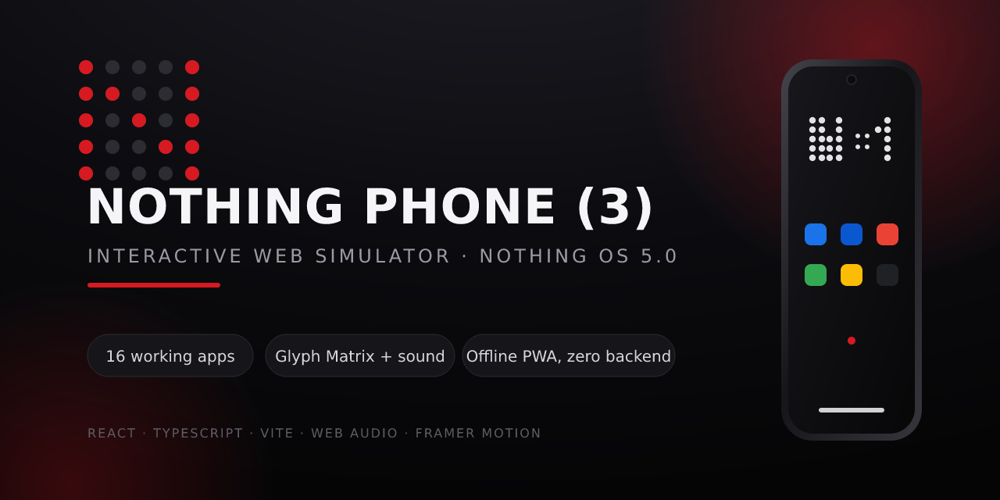
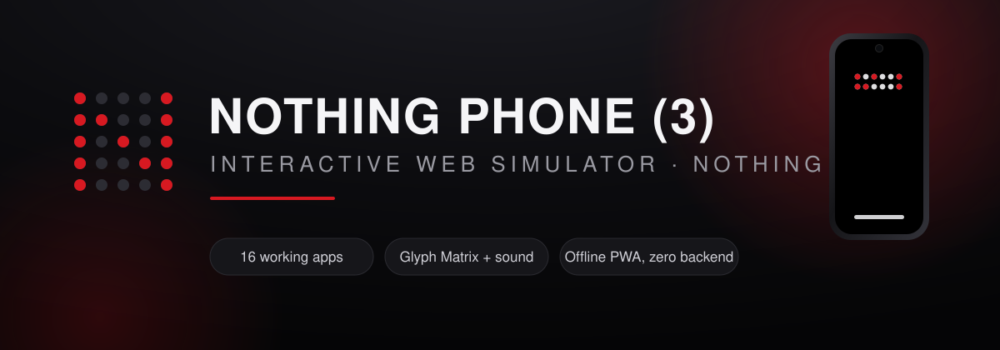

# Nothing Phone (3) — Interactive Web Simulator





A fully interactive, web-based simulation of the **Nothing Phone (3)** running **Nothing OS 5.0**.
It is not a picture of a phone — it boots, locks, launches apps, lights up its Glyph Matrix, plays
synthesized UI sounds, keeps state across reloads, and ships with **16 real, usable applications**
(including a browser simulator and a full double-entry accounting app).

Built with **React + TypeScript + Vite + Zustand + Framer Motion + Web Audio**, styled after
Nothing's black / white / red dot-matrix design language. Zero backend, fully offline-capable PWA.

### ▶️ [Open the live demo](https://hoseinsedaqat.github.io/Nothing-Phone/)

[](https://github.com/hoseinsedaqat/Nothing-Phone/actions/workflows/deploy.yml)
[](https://vitejs.dev/)
[](https://www.typescriptlang.org/)
[](https://react.dev/)
[](#tests)

---

## Highlights

- 📱 **Pixel-faithful hardware frame** — aluminum mid-frame, centered punch-hole, power key with
  Nothing-red accent, volume rocker, SIM tray, antenna bands, USB-C, speaker grilles, IR blaster
  and curved-glass reflection.
- 🔓 **Lock screen** — authentic LED dot-matrix clock, tap-anywhere or swipe-up unlock, compact
  notification stack, flashlight/camera shortcuts, optional demo PIN.
- 🌙 **Always-On Display** — after the screen timeout, a dim dot-matrix AOD shows time, battery and
  unread count; tap anywhere to wake. Toggle in Settings → Display.
- 🔋 **Charging experience** — connect the simulated charger (Settings → Battery) for a ring
  animation, lock-screen pill and a green wave across the rear Glyph Matrix, with connect/unplug sounds.
- 🎵 **Real synthesized music player** — the control-center media card runs a Web Audio step
  sequencer (lead, bass, kick, hi-hat) across three tracks, with live progress, prev/next and an
  animated equalizer. Five melodic ringtones are synthesized per-note in Settings → Sound.
- 🔘 **Nothing-style control center** — circular quick toggles, unified brightness/volume pill
  sliders, media card, long-press a tile to jump to its settings.
- 💡 **Glyph Matrix (rear view)** — pulse / wave / ripple / volume-meter / matrix effects,
  intensity control, Glyph clock and Glyph Timer, with synthesized power-up/power-down sounds.
- 🔊 **Synthesized sound engine** — every sound (unlock chime, Glyph sweeps, camera shutter,
  DTMF dial tones, notification chime, key ticks) is generated live with the Web Audio API.
  No audio files, works offline; respects Silent mode, DND and a master Sound-effects switch.
- 🧩 **16 functional apps** — every button works, every page has content, every limitation is
  labeled honestly instead of faking hardware.
- 💾 **Real persistence** — segmented, crash-resilient LocalStorage with export/import;
  corrupt data in one slice never takes down the phone.
- 🪟 **Real multitasking** — recents with previews, plus up to two draggable, resizable
  floating windows.
- 📲 **Installable PWA** — service worker offline shell, manifest, dot-matrix favicon.

## Quick start

```bash
npm install
npm run dev        # start the dev server (http://localhost:5173)
npm run build      # type-check + production build to dist/
npm run preview    # serve the production build
npm test           # run the Vitest + Testing Library suite
```

The dev server binds to `0.0.0.0` and allows the sandbox preview host (`server.allowedHosts`).

## Gestures & keyboard

| Action | Gesture / key |
| --- | --- |
| Unlock | Tap anywhere on the lock screen, or swipe up |
| Notifications / Quick Settings | Drag down from the top edge (forgiving 96px trigger zone) |
| Home / App drawer | Swipe up from the bottom edge |
| Back | Swipe from either screen edge, the glass back button, or `Esc` |
| Recents | Recents button, or long-press the home pill |
| Power menu | Long-press the physical side power key |
| Volume | Physical side volume keys (also wired to media volume) |

## Project structure

```
src/
├── os/                    # Operating-system layer (framework-agnostic logic)
│   ├── store.ts           # Central Zustand store: system, launcher, notifications, recents
│   ├── dataStore.ts       # Per-app persisted data (browser, accounting, PIM, media…)
│   ├── storage.ts         # Versioned, segmented, crash-resilient LocalStorage layer
│   ├── registry.tsx       # Modular app registry — add an app here, no core changes needed
│   ├── icons.tsx          # Hand-built SVG brand icon set for all 16 apps
│   ├── sound.ts           # Web Audio synthesized UI sound engine
│   ├── types.ts           # Shared domain types
│   ├── hooks.ts           # useNow, useScreenStack (back navigation), haptics, media queries
│   └── back.ts            # Back-gesture context
├── components/
│   ├── PhoneStage.tsx     # Hardware frame, gestures, power/volume keys, stage controls
│   ├── lock/              # Lock screen, PIN pad, lock notifications
│   ├── launcher/          # Home screen, widgets, App Drawer
│   ├── shade/             # Notification shade + Quick Settings
│   ├── glyph/             # Rear Glyph Matrix simulation (Back View)
│   ├── system/            # AppWindow, Recents, Floating windows, Global Search, Toast, Boot…
│   └── ui.tsx             # Shared Nothing-style primitives (Switch, Slider, Sheet, Dialog…)
├── apps/                  # 16 self-contained applications
│   ├── settings/          # Full Settings with every section
│   ├── chrome/            # Browser simulator (tabs, history, bookmarks, iframe + fallback)
│   ├── accounting/        # Real double-entry-style CRUD finances, reports, CSV
│   └── …                  # Phone, Messages, Camera, Photos, Clock, Calendar, Files, Recorder…
├── styles/                # Design tokens, wallpapers, global CSS
└── test/                  # Vitest unit / integration / component / coverage tests
public/
├── manifest.webmanifest   # PWA manifest (installable)
├── favicon.svg            # Dot-matrix N favicon
└── sw.js                  # Offline-first service worker
```

## Applications — all functional, no dead buttons

| App | What works |
| --- | --- |
| **Settings** | Network, Bluetooth pairing, display, personalisation (wallpaper/accent/icon style), app info & data clearing, notifications, sound with WebAudio preview, battery chart, measured storage, PIN & Private Space, Glyph, language, backup export/import, full reset, About Phone |
| **Chrome** | Multi-tab browsing, incognito, smart address parsing, real iframes with an explicit framing-block fallback + "open externally", bookmarks, history, downloads, 3 search engines |
| **Accounting** | Accounts (CRUD) with correct balances, income/expense/transfers, categories, filters, search, reports, category breakdown, CSV/JSON export, sample data, wipe with confirmation |
| **Phone** | DTMF-toned dialer, simulated call screen with timer, call history |
| **Messages** | Threads, send, simulated replies, notifications, delete |
| **Contacts** | CRUD, favorites, search, color avatars |
| **Camera** | Real webcam via `getUserMedia` when permitted, animated demo viewfinder otherwise; **the shutter always saves a real JPEG** (live frame or painted canvas fallback) |
| **Photos** | Albums, viewer, set-as-wallpaper, download, delete |
| **Calendar** | Month grid, event CRUD with colors/times |
| **Clock** | Alarms (fire notifications), world clocks, stopwatch, countdown timer |
| **Calculator** | Full arithmetic with error handling |
| **Weather** | Simulated multi-city forecast, add/remove, refresh |
| **Files** | Virtual file system, folders, text editor, download, recursive delete |
| **Recorder** | `MediaRecorder` capture with demo fallback, playback, delete |
| **Essential Space** | Notes CRUD, pin, colors, search |
| **Play Store** | Simulated catalog with honest install/open states |

## Data & persistence

- Each top-level slice is stored separately under versioned `np3:v1:*` LocalStorage keys.
- Corrupt JSON for one slice never breaks the others; missing fields are merged with defaults.
- Writes are debounced and flushed on tab hide/unload; full export/import and per-slice reset
  are available in Settings. Reset requires explicit confirmation.

## Tests

`npm test` runs **98 tests** across 9 suites:
- storage resilience (corrupt JSON, migrations/merges, export/import, reset),
- accounting math (balances, transfers cannot create money, categories, CSV),
- browser helpers (URL normalization, tab lifecycle, incognito history),
- OS store (recents, notifications opt-out, floating window limits, launcher moves),
- sound engine (synthesized notes, DTMF pairs, melodic ringtones, charge sounds, DND/silent muting, no-throw fallback),
- music sequencer (play/pause, track cycling, step scheduling, snapshot stability) and charging overlay,
- stylesheet coverage guard (every CSS file must be imported — prevents invisible-component regressions),
- component/integration smoke tests that boot the whole simulator, unlock it with a tap,
  open every app and exercise the control center.

## Honest limitations (simulation boundaries)

This is a web page, not a phone OS, so it **cannot**:
- control real radios, LEDs, physical buttons, screen hardware or telephony — Wi-Fi, Bluetooth,
  flashlight, Glyph, calls and SMS are all **simulated state**;
- run a real Chromium engine — Chrome is a browser **simulator** using iframes, and sites that
  send `X-Frame-Options`/CSP framing restrictions show an explicit fallback instead of a blank page;
- provide real security — the PIN is a demo lock, never a security boundary;
- install third-party apps — Play Store listings are illustrative.

Camera/microphone use genuine browser Web APIs (with permission) and gracefully fall back to
demo modes when denied or unsupported.

## Repo social preview

`docs/social-preview.png` (1280×640) is generated from `docs/social-preview.svg` via
`npm run social` (uses the dev-only `@resvg/resvg-js` rasterizer). To use it as the repository's
social preview image, upload it manually at **Settings → General → Social preview** — the GitHub
API token used in CI lacks the admin scope required to upload it programmatically.

## Deployment

Automatically deployed to GitHub Pages on every push to `test`/`main` via
`.github/workflows/deploy.yml` (Vite base path derived from `actions/configure-pages`, so all
assets work under the `/Nothing-Phone/` subpath).
