<div align="center">

# 📱 Nothing Phone (3) Simulator — Interactive Nothing OS 5.0 in Your Browser

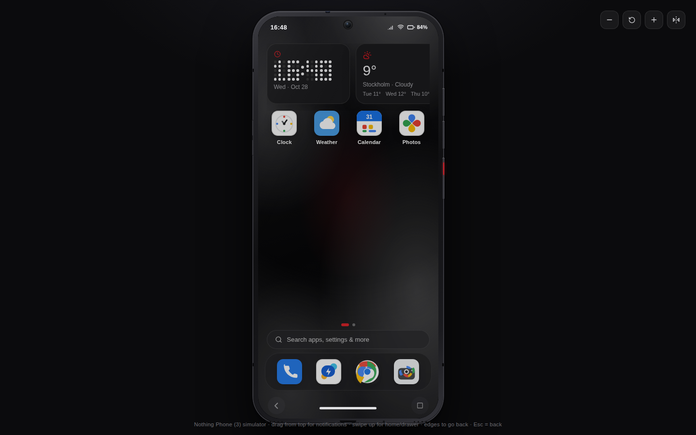

**A pixel-faithful, fully interactive web simulation of the Nothing Phone (3) running Nothing OS 5.0 — built with React, TypeScript and the Web Audio API. No backend, no native build, runs 100% in the browser and installs as an offline PWA.**

### 👉 **[Launch the live demo](https://hoseinsedaqat.github.io/Nothing-Phone/)**

[](https://github.com/hoseinsedaqat/Nothing-Phone/actions/workflows/deploy.yml)


</div>

---

## Table of contents

- [What is this?](#what-is-this)
- [Live demo](#live-demo)
- [Screenshots](#screenshots)
- [Feature tour](#feature-tour)
- [The 16 built-in apps](#the-16-built-in-apps)
- [Tech stack](#tech-stack)
- [Architecture](#architecture)
- [Getting started](#getting-started)
- [Gestures & keyboard](#gestures--keyboard)
- [Data & persistence](#data--persistence)
- [Testing](#testing)
- [FAQ](#faq)
- [Honest limitations](#honest-limitations-simulation-boundaries)
- [Deployment](#deployment)
- [Contributing](#contributing)
- [License](#license)

---

## What is this?

This is **not a screenshot or a video** — it is a working phone rendered entirely with web
technologies. The Nothing Phone (3) simulator boots, locks, launches apps, lights up its rear
**Glyph Matrix**, plays **synthesized sound effects and music**, multitasks with floating
windows, and keeps every piece of your data across browser reloads.

It recreates Nothing's signature design language — black/white surfaces, the red `#D71921`
accent, LED dot-matrix typography and circular monochrome/color app icons — inside a realistic
hardware frame with an aluminum mid-frame, punch-hole camera, physical side keys, USB-C,
speaker grilles and antenna bands.

> 💡 **Keywords:** Nothing Phone (3) simulator · Nothing OS 5.0 simulation · web-based phone OS ·
> Glyph Matrix simulation · React phone UI · online phone simulator · browser PWA demo

## Live demo

**[https://hoseinsedaqat.github.io/Nothing-Phone/](https://hoseinsedaqat.github.io/Nothing-Phone/)**

Deployed automatically from the `test` branch via GitHub Actions. Open it on desktop or mobile,
or use your browser's **"Install app" / "Add to Home screen"** option to run it as a standalone PWA.

## Screenshots

Every image below is a **real, unedited render of this project** — the actual React app driven by
Playwright in CI (`.github/workflows/screenshots.yml`), not mockups, stock art or edited
composites. The machine-readable responsive report lives next to them at
[`docs/screenshots/responsive-audit.json`](docs/screenshots/responsive-audit.json).

<table>
<tr>
<td align="center" width="33%">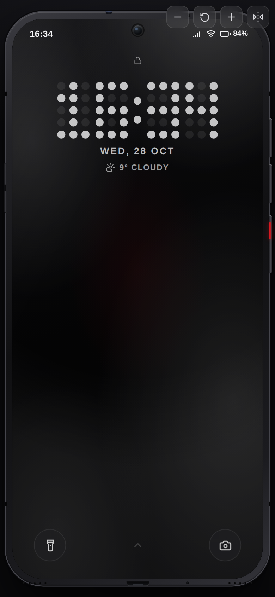<br><sub>Lock screen · LED dot-matrix clock</sub></td>
<td align="center" width="33%">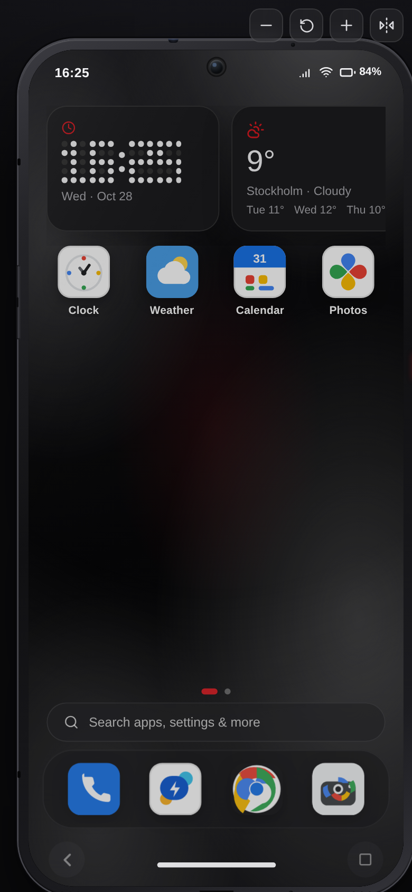<br><sub>Home screen · widgets & dock</sub></td>
<td align="center" width="33%">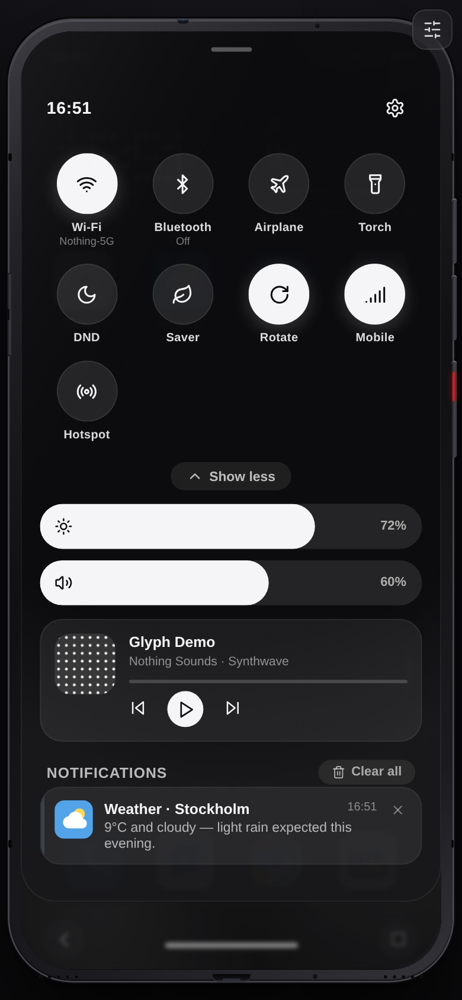<br><sub>Control center · toggles & sliders</sub></td>
</tr>
<tr>
<td align="center">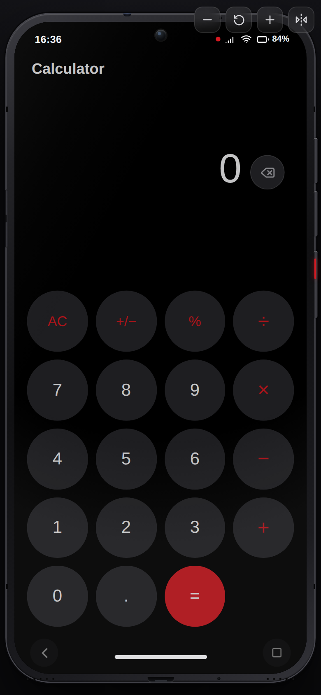<br><sub>Calculator · Nothing-red keypad</sub></td>
<td align="center">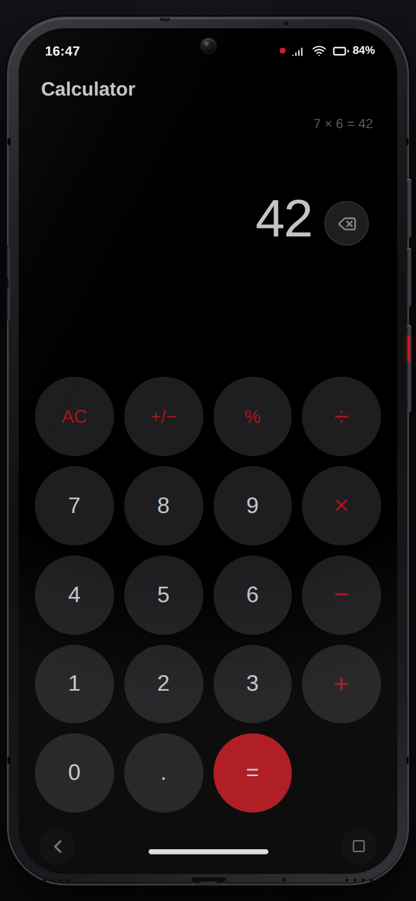<br><sub>Calculator · 7 × 6 = 42</sub></td>
<td align="center">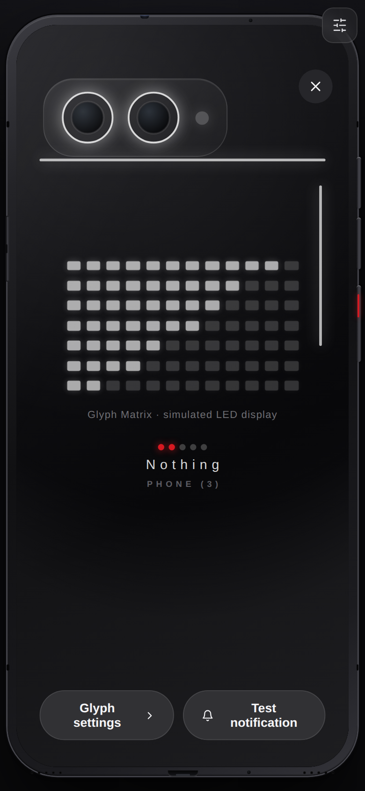<br><sub>Glyph Matrix · simulated LEDs</sub></td>
</tr>
<tr>
<td align="center">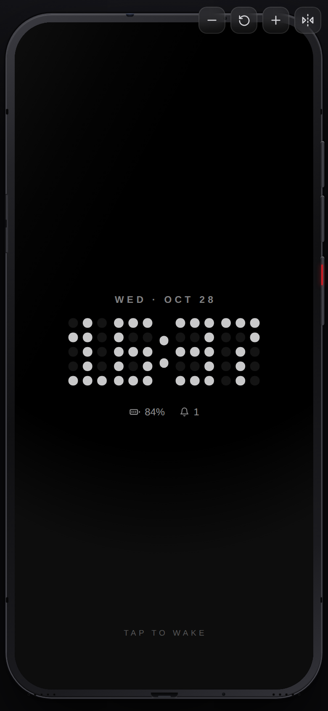<br><sub>Always-On Display · tap to wake</sub></td>
<td align="center">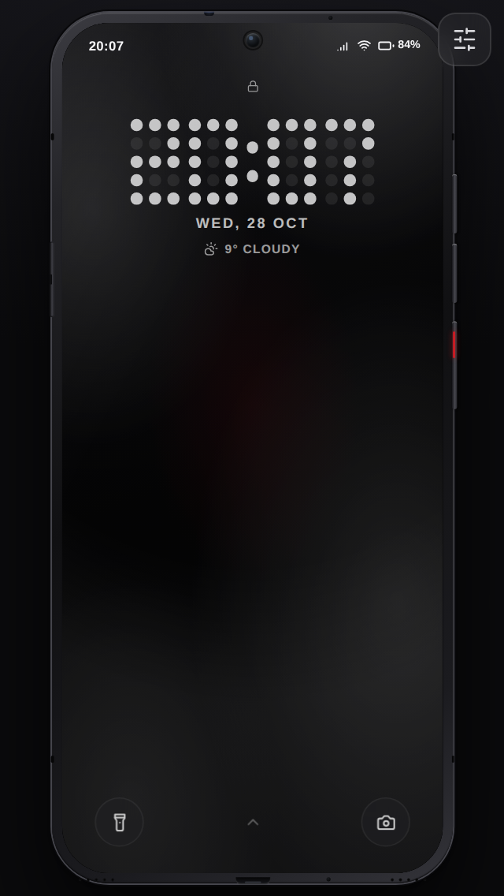<br><sub>Small phone · 320×568, full frame</sub></td>
<td align="center"><br><sub>Desktop stage · 1440×900</sub></td>
</tr>
<tr>
<td align="center" colspan="3">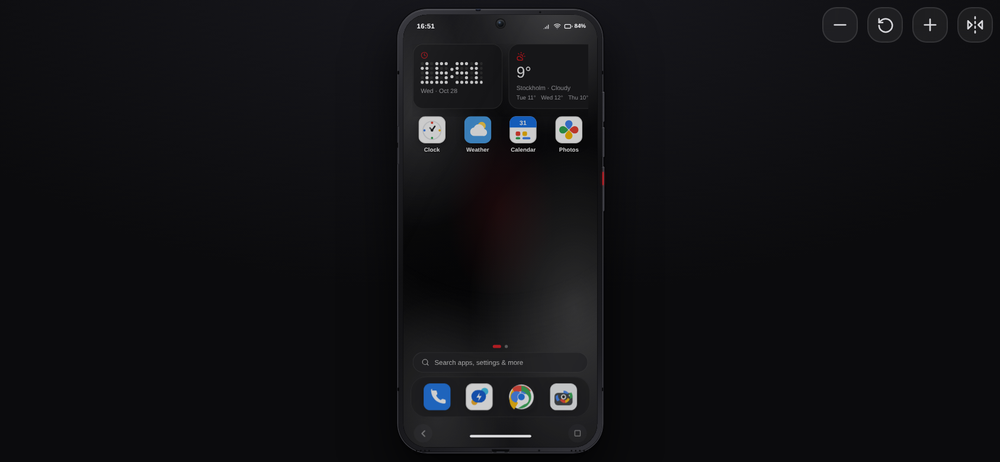<br><sub>Landscape · 844×390, frame fully visible</sub></td>
</tr>
<tr>
<td align="center" colspan="3">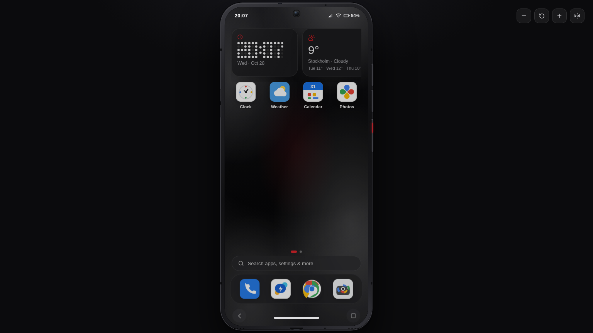<br><sub>Wide laptop · 1536×864, frame centered with clean side gutters</sub></td>
</tr>
</table>

## Feature tour

### 🔒 Lock screen & Always-On Display

- Authentic **3×5 LED dot-matrix clock** rendered as a reusable React component.
- **Tap anywhere (or swipe up) to unlock** — no finicky gesture-only unlock.
- Compact notification stack capped at two cards with a "+N more" hint; notifications never
  flood the center of the screen.
- Circular flashlight and camera shortcuts; optional 4–6 digit demo PIN with a sliding PIN pad.
- **Always-On Display (AOD):** after the screen timeout, a dim dot-matrix clock with battery and
  unread count stays on; tap anywhere to wake. Toggle in *Settings → Display*.

### 🎛️ Control center & notification shade

- Nothing-style **circular quick toggles** in a 4-column grid (Wi-Fi, Bluetooth, Airplane,
  Torch, DND, Battery Saver, Auto-rotate, Hotspot, Mobile data).
- Brightness and volume share **one identical pill-slider geometry** — coordinated drag, fill
  and icon placement. Long-press a tile to jump straight to its settings page.
- A **real media player card** wired to the built-in synth engine, with an animated equalizer
  and live progress.

### 💡 Glyph Matrix (rear view)

Flip the phone (stage control) to reveal the back with a horizontal twin-lens camera island and
the LED matrix. It supports five patterns — **pulse, wave, ripple, volume meter and matrix rain**
— plus intensity control, a Glyph clock and a Glyph Timer. Connecting the simulated charger runs
a **green charging wave across the whole matrix**, and every state change plays a synthesized
power-up/power-down sweep.

### 🔊 Synthesized audio — zero audio files

Every sound is generated live with the **Web Audio API**, so the PWA stays tiny and works offline:

| Sound | Where |
| --- | --- |
| Unlock chime / lock click | Lock screen transitions |
| Glyph & torch power sweeps | Rear view, flashlight |
| Mechanical shutter | Camera capture |
| DTMF dual-tones | Dialer keypad |
| Five melodic ringtones | Settings → Sound (note-by-note synthesis) |
| Music sequencer | Control-center media card (lead, bass, kick, hi-hat) |
| Charging connect/unplug | Simulated charger |

Muted automatically by Silent mode, Do-Not-Disturb or the master Sound-effects switch; volume
follows the system media/ring sliders.

### 📱 Hardware-level detail

Aluminum mid-frame gradient, antenna bands, red-accented power key, volume rocker, SIM tray,
IR blaster, USB-C port, twin speaker grilles, punch-hole lens glint and a curved-glass reflection
overlay — all pure CSS/SVG, all responsive from full-screen phones to small desktop windows.

### 🪟 Multitasking & system shell

- Recents screen with live previews, dismiss all/single.
- Up to **two draggable, resizable floating windows**.
- Global search across apps, settings, contacts, transactions and notes.
- Boot animation, power menu, screen-timeout auto-lock, haptics (`navigator.vibrate`).
- 16 hand-built **SVG brand icons** (monochrome or full-color mode), wallpapers and accent themes.

## The 16 built-in apps

Every app is functional — no dead buttons, no blank pages. If a hardware capability can't exist
on the web, the app says so honestly instead of faking it.

| App | What actually works |
| --- | --- |
| **Settings** | Network, Bluetooth pairing, display & AOD, personalization, app info, notifications, ringtones with audio preview, battery chart, storage measurement, PIN & Private Space, Glyph controls, language, backup export/import, full reset, About Phone |
| **Chrome** | Multi-tab browser simulator, incognito, smart address parsing, real iframes with an explicit framing-block fallback and "open externally", bookmarks, history, downloads, three search engines |
| **Accounting** | Double-entry-style accounts (CRUD) with correct balances, income/expense/transfers, categories, filters, search, monthly/yearly reports, category breakdown, CSV/JSON export |
| **Phone** | DTMF-toned dialer, simulated call screen with timer, call history |
| **Messages** | Threads, send, simulated replies, notifications, delete |
| **Contacts** | CRUD, favorites, live search, color avatars |
| **Camera** | Real webcam via `getUserMedia` when permitted; animated demo viewfinder otherwise — **the shutter always saves a real JPEG** (live frame or painted canvas fallback) into Photos |
| **Photos** | Albums, full-screen viewer, set-as-wallpaper, download, delete |
| **Calendar** | Month grid, event CRUD with colors and times |
| **Clock** | Alarms that fire notifications, world clocks, stopwatch, countdown timer |
| **Calculator** | Full arithmetic with graceful error handling (including divide-by-zero) |
| **Weather** | Simulated multi-city forecast, add/remove cities, refresh |
| **Files** | Virtual file system, folders, built-in text editor, download, recursive delete |
| **Recorder** | `MediaRecorder` capture with a demo-mode fallback, playback, delete |
| **Essential Space** | Notes CRUD, pin, colors, search |
| **Play Store** | Simulated catalog with honest install/open states (no real downloads) |

## Tech stack

| Layer | Technology |
| --- | --- |
| UI framework | **React 18** + **TypeScript 5** (strict mode) |
| Build tool | **Vite 5** |
| State management | **Zustand** (OS store + per-app data store) |
| Animation | **Framer Motion** |
| Audio | **Web Audio API** (custom synth engine + step sequencer) |
| Styling | Modular CSS with design tokens, no UI framework |
| Icons | Hand-authored SVG brand marks + `lucide-react` glyphs |
| Testing | **Vitest** + Testing Library (100 tests, jsdom) |
| Offline | Service worker + web manifest (installable PWA) |
| Deployment | GitHub Actions → GitHub Pages (base-path aware) |

## Architecture

The OS logic is deliberately separated from the UI, so the "operating system" can be tested
without rendering a single component:

```
src/
├── os/                    # Framework-agnostic OS layer
│   ├── store.ts           # Zustand store: system, launcher, notifications, recents
│   ├── dataStore.ts       # Per-app persisted data (browser, accounting, PIM, media…)
│   ├── storage.ts         # Versioned, segmented, crash-resilient LocalStorage
│   ├── registry.tsx       # Modular app registry — register an app, touch nothing else
│   ├── icons.tsx          # Hand-built SVG brand icon set for all 16 apps
│   ├── sound.ts           # Synthesized UI sounds + melodic ringtones
│   ├── music.ts           # Web Audio step-sequencer music engine
│   ├── types.ts           # Shared domain types
│   └── hooks.ts           # useNow, useScreenStack, haptics, media queries
├── components/
│   ├── PhoneStage.tsx     # Hardware frame, gesture engine, physical keys
│   ├── lock/              # Lock screen, PIN gate, Always-On Display
│   ├── launcher/          # Home screen, widgets, app drawer
│   ├── shade/             # Notification shade + Quick Settings
│   ├── glyph/             # Rear Glyph Matrix
│   └── system/            # AppWindow, Recents, floating windows, charging overlay…
├── apps/                  # 16 self-contained applications
├── styles/                # Design tokens, wallpapers, global CSS
└── test/                  # Unit, component and integration suites
```

Adding a new app means dropping a component in `src/apps/` and one entry in the registry —
the launcher, recents, search, floating windows and permissions model pick it up automatically.

## Getting started

**Prerequisites:** Node.js 18+ and npm.

```bash
# 1. Install dependencies
npm install

# 2. Start the dev server (http://localhost:5173)
npm run dev

# 3. Type-check + production build to dist/
npm run build

# 4. Preview the production build
npm run preview

# 5. Run the full test suite (100 tests)
npm test

# 6. Regenerate the GitHub social preview PNG from its SVG source
npm run social
```

The dev server binds to `0.0.0.0` with `server.allowedHosts` enabled for sandboxed previews.

## Gestures & keyboard

| Action | Gesture / key |
| --- | --- |
| Unlock | Tap anywhere on the lock screen, or swipe up |
| Notifications / Quick Settings | Drag down from the top edge (works **inside apps too** — dedicated touch-capture strips prevent scroll hijacking) |
| Home / app drawer | Swipe up from the bottom edge |
| Back | Swipe either screen edge, tap the glass back button, or press `Esc` |
| Recents | Recents button, or long-press the home pill |
| Power menu | Long-press the physical side power key |
| Volume | Physical side volume keys (wired to media volume) |

## Data & persistence

- Each top-level slice is stored separately under versioned `np3:v1:*` LocalStorage keys.
- Corrupt JSON in one slice never breaks the others; missing fields are deep-merged with defaults.
- Writes are debounced and flushed on tab hide/unload.
- Full JSON export/import and per-slice reset live in Settings; destructive resets require
  explicit confirmation, and your data always survives refreshes.

## Testing

`npm test` executes **100 tests across 9 suites**:

- **Storage resilience** — corrupt JSON, migrations, export/import, reset
- **Accounting math** — balances, transfers that cannot create money, categories, CSV
- **Browser simulator** — URL normalization, tab lifecycle, incognito history
- **OS store** — recents, notification opt-out, floating-window limits, launcher moves
- **Sound & music** — synthesized notes, DTMF pairs, ringtones, charge sounds, DND/silent
  muting, sequencer scheduling, no-throw fallback when Web Audio is unavailable
- **Stylesheet coverage guard** — every CSS file must be imported (prevents invisible-component
  regressions like the transparent AppWindow bug)
- **Integration** — full boot, tap-to-unlock, AOD wake, shade gesture inside apps (including
  `pointercancel`), and opening all 16 apps without crashing

## FAQ

**Can I use the simulator offline?**
Yes. It is a Progressive Web App with a service worker that caches the shell. Use "Install app"
or "Add to Home screen" and it launches standalone without a network connection.

**Does it need a server or backend?**
No backend, no database, no accounts. All state lives in your browser's LocalStorage and all
audio is synthesized locally.

**Is the PIN a real security feature?**
No — it is a demo lock to simulate the Nothing OS experience. A web page cannot provide a real
security boundary, and this is stated inside the app as well.

**How is the Glyph Matrix simulated?**
The rear LED patterns are CSS/React animations driven by system state (notifications, charging,
media volume). The accompanying power-up/down sounds are Web Audio oscillators — there is no way
for a website to control the physical LEDs of a real Nothing Phone.

**Can I install real Android apps from the Play Store screen?**
No. The store is an honest simulation with illustrative listings; third-party apps are never
really downloaded or executed.

**Why does the camera show a painted scene?**
If webcam permission is denied or unavailable, the app falls back to an animated demo viewfinder,
and the shutter still saves a real JPEG rendered on a canvas — the camera is never a dead screen.

**Which browsers are supported?**
Any modern Chromium, Firefox or Safari release with Pointer Events and Web Audio. Chrome/Edge
give the most faithful PWA installation experience.

## Honest limitations (simulation boundaries)

This is a web page, not a phone OS, so it **cannot**:

- control real radios, LEDs, physical buttons, screen hardware or telephony — Wi-Fi, Bluetooth,
  flashlight, Glyph, calls and SMS are **simulated state**;
- run a real Chromium engine — the Chrome app is a browser **simulator** using iframes, and sites
  that send `X-Frame-Options`/CSP framing restrictions show an explicit fallback instead of a
  blank page;
- provide real security — the PIN is a demo lock, never a security boundary;
- install third-party apps — Play Store listings are illustrative.

Camera and microphone use genuine browser Web APIs (with your permission) and gracefully fall
back to demo modes when denied or unsupported.

## Deployment

Automatically deployed to **GitHub Pages** on every push to `test`/`main` via
`.github/workflows/deploy.yml`. The Vite base path is derived from `actions/configure-pages`,
so all assets resolve correctly under the `/Nothing-Phone/` project subpath. The deploy job is
skipped on feature branches to respect the protected Pages environment.

### Screenshot & responsive-audit workflow

Pushes to `arena/**` branches (plus manual dispatch) trigger
`.github/workflows/screenshots.yml`: it builds the app, runs Playwright Chromium against the
production preview at **390×844, 320×568, 844×390 (landscape), 1440×900 and 1536×864 (wide laptop)**,
writes eleven real-render PNGs plus `docs/screenshots/responsive-audit.json` (horizontal-overflow,
frame-fit and screen-size checks — any violation fails the job), and commits the refreshed
captures back to the branch. The README gallery above is generated
entirely from these genuine captures — no mockup or placeholder imagery.

The 1280×640 social banner at `docs/social-preview.png` (a designed OG/link-preview asset, not a
product screenshot) is regenerated from its SVG source with `npm run social`
(dev-only `@resvg/resvg-js` rasterizer).

## Contributing

1. Fork the repository and create a feature branch.
2. Keep OS logic in `src/os/` and presentation in `src/components/` / `src/apps/`.
3. Add tests — new behavior should ship with Vitest coverage.
4. Run `npm run build` and `npm test` before opening a pull request.
5. Simulated hardware features must be labeled as simulations; never claim real device control.

## License

Released under the **[MIT License](LICENSE)** — use it, fork it, learn from it.

<div align="center">

**Made with the Nothing design language · black, white and a little red.**

</div>
